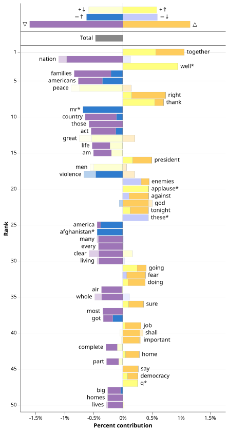

<picture>
  <source media="(prefers-color-scheme: dark)" srcset="docs/assets/images/full_logo_dark_mode.svg">
  
</picture>

[](https://pypi.org/project/wordlevel/)
[](https://pypi.org/project/wordlevel/)
[](https://github.com/ryanjgallagher/wordlevel/actions/workflows/test.yaml)
[](https://wordlevel.dev)
[](https://doi.org/10.1140/epjds/s13688-021-00260-3)
[](LICENSE)

WordLevel is an open-source library for word-level natural language processing and text analysis.
It measures how two bodies of text differ token by token, and turns that measurement into a
publication-ready [word shift graph](https://wordlevel.dev/documentation/concepts/word_shift_graphs/):
a chart that shows not only _which_ words distinguish two corpora, but _how_ each one contributes.

## Install

WordLevel runs on Python 3.10 and above, and installs with any Python package manager. See the
[install guide](https://wordlevel.dev/documentation/install/) for details.

```bash
pip install wordlevel
```


## Compare texts

The code below compares the speeches of Presidents Franklin D. Roosevelt and Joe Biden by
sentiment, scoring each president with a lexicon from each era.

```python
import wordlevel as wl

speeches = wl.Dataset("presidential_speeches")

cl = wl.Catalog(speeches, corpora=["Franklin D. Roosevelt", "Joe Biden"])

cl = cl.with_comparisons(
    wl.comp("Franklin D. Roosevelt", "Joe Biden")
        .score.lexicon(
            lexicon_reference=wl.lex.SocialSent("1940"),
            lexicon_comparison=wl.lex.SocialSent("2000"),
            reference_score="center",
        )
        .normalize(by="total_diff")
        .alias("roosevelt_biden"),
)

chart = cl.plot.shift("roosevelt_biden", show_totals=True)
```

<picture>
  <source media="(prefers-color-scheme: dark)" srcset="docs/assets/images/cover_word_shift_graph_dark.svg">
  
</picture>

Biden's speeches score lower in sentiment overall. From the word shift graph, we can see that 
most of the gap comes from words like "nation," "families," and "americans" carrying lower sentiment 
in the 2000s lexicon than the 1940s one (▽), only partly offset by Biden using relatively positive 
words such as "together" and "well" more often (+↑).


## Where to go next

- **[Quick Start](https://wordlevel.dev/documentation/install/)** — install the package, make your
  first comparison, and build a word shift graph.
- **[Cookbooks](https://wordlevel.dev/documentation/cookbooks/constructing_catalogs/)** —
  task-by-task recipes for constructing catalogs, scoring, and plotting.
- **[Concepts](https://wordlevel.dev/documentation/concepts/corpora_and_catalogs/)** — the ideas
  behind corpora, comparisons, and word shift graphs.
- **[API Reference](https://wordlevel.dev/documentation/api/)** — every public class, method, and
  configuration, generated from the source.


## Citation

If you use WordLevel in your research, please cite the following paper:

> Gallagher, R. J., Frank, M. R., Mitchell, L., Schwartz, A. J., Reagan, A. J., Danforth, C. M., &
> Dodds, P. S. (2021). [Generalized word shift graphs: a method for visualizing and explaining
> pairwise comparisons between texts](https://link.springer.com/article/10.1140/epjds/s13688-021-00260-3).
> _EPJ Data Science_, 10(1), 4.


## License

WordLevel is released under the [MIT License](LICENSE).


## AI Disclosure

AI tools have been used to assist in the development of this package, including Claude Opus 4 & 5 
and Gemini 3 Pro. I have opted to use AI for this project because I have found it to be a useful
sounding board, learning resource, and agent for development. Despite its usefulness, I recognize 
that AI tools have a variety of negative social, economic, and ecological effects. I do not make 
excuses for these externalities, and I continue to try and navigate the tension between the
usefulness of AI tools in software development and their threat as a larger social and political 
project.

The ideas for this package—including its architecture and design—all came from me and the lessons 
that I learned developing one of the original packages for word shift graphs, Shifterator. Any and 
all code produced by AI tools has been reviewed by me for correctness, clarity, and style. Within 
the bounds of the license, I take responsibility for errors in the code and documentation. 

I have been developing code on this subject for nearly a decade. I hope that you are able to see the 
care that I have taken to make it accessible through this package.